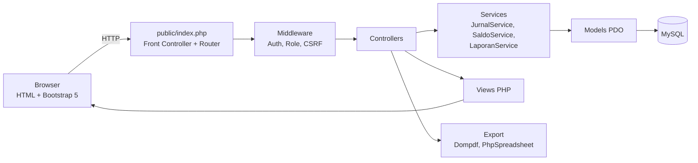
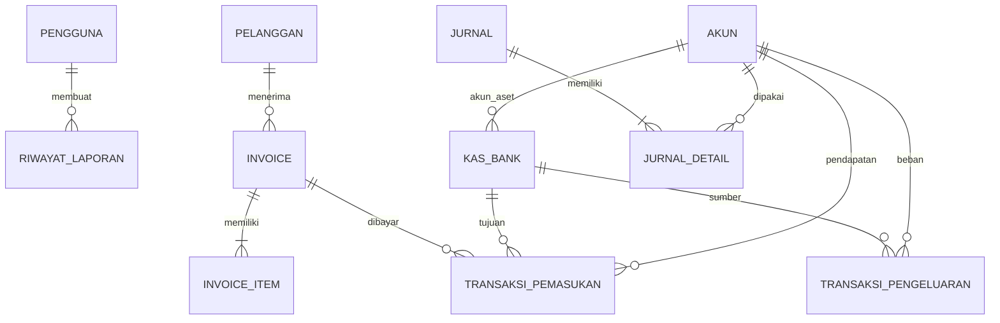
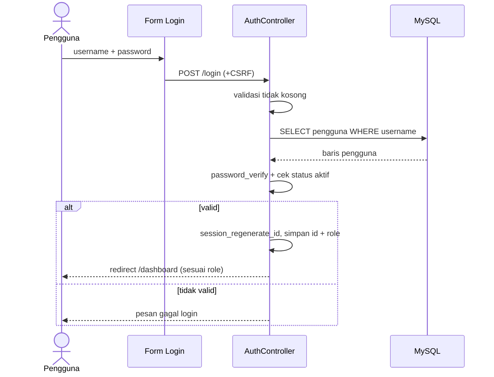
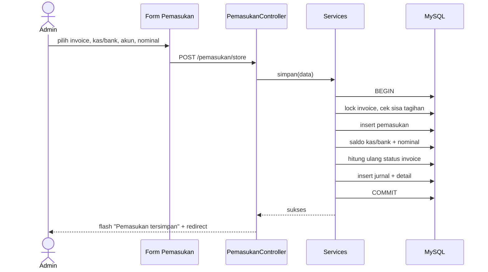
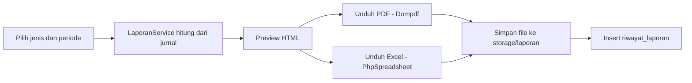

# DESIGN — Sistem Informasi Keuangan PT. Bali Surya Sentosa

Dokumen desain teknis dan UI. Kebutuhan produk ada di `PRD.md`.

**Daftar isi**
1. Arsitektur
2. Struktur Folder
3. Database (SQL)
4. Logika Akuntansi dan Jurnal Otomatis
5. Rumus Laporan
6. Routing dan Halaman
7. Alur Proses Kunci (sequence)
8. Desain UI (design system)
9. Wireframe Halaman
10. Keamanan
11. Pengujian
12. Deployment

---

## 1. Arsitektur

Aplikasi PHP native dengan pola **MVC sederhana** (tanpa framework) agar sesuai tools di dokumen seminar (HTML, CSS, PHP, MySQL, XAMPP).



### Teknologi
| Lapisan | Pilihan |
|---|---|
| Server lokal | XAMPP (Apache 2.4, PHP 8.1+, MySQL/MariaDB) |
| Backend | PHP 8.1+, PDO, Composer |
| Frontend | HTML5, Bootstrap 5.3, Bootstrap Icons, sedikit JavaScript (fetch/AJAX untuk pencarian), Chart.js (grafik dashboard) |
| PDF | `dompdf/dompdf` |
| Excel | `phpoffice/phpspreadsheet` |
| Desain database | Power Designer (CDM/PDM) |

### Prinsip
- Semua perubahan saldo/status berjalan di **satu transaksi database** (`BEGIN … COMMIT`).
- Logika bisnis ada di **Services**, bukan di view.
- Akses dicek di **server** (middleware), bukan hanya menyembunyikan menu.

---

## 2. Struktur Folder

```
sik-bss/
├── public/                    # satu-satunya folder yang diakses web
│   ├── index.php              # front controller
│   └── assets/ (css, js, img)
├── app/
│   ├── config/ (app.php, database.php)
│   ├── core/ (Router.php, Controller.php, Database.php, Auth.php, Csrf.php, Flash.php)
│   ├── middleware/ (AuthMiddleware.php, RoleMiddleware.php)
│   ├── controllers/
│   │   ├── AuthController.php
│   │   ├── DashboardController.php
│   │   ├── AkunController.php
│   │   ├── PelangganController.php
│   │   ├── KasBankController.php
│   │   ├── InvoiceController.php
│   │   ├── PemasukanController.php
│   │   ├── PengeluaranController.php
│   │   ├── LaporanController.php
│   │   ├── RiwayatController.php
│   │   ├── PengaturanController.php   # kop perusahaan + ganti password
│   │   └── ProfilController.php
│   ├── models/ (satu model per tabel)
│   ├── services/
│   │   ├── JurnalService.php
│   │   ├── SaldoService.php
│   │   ├── InvoiceService.php         # item, PPN, status
│   │   ├── KopService.php             # ambil kop (atau placeholder) untuk cetak
│   │   └── LaporanService.php
│   └── views/
│       ├── layouts/ (auth.php, app.php, partials: sidebar, topbar, flash)
│       ├── auth/, dashboard/, akun/, pelanggan/, kas_bank/,
│       ├── invoice/, pemasukan/, pengeluaran/, laporan/, riwayat/, pengaturan/
│       └── partials/kop.php           # kop dipakai bersama oleh invoice dan laporan
├── storage/ (laporan/, bukti/, kop/, logs/)
├── database/ (schema.sql, seed.sql)
├── vendor/                    # composer
└── composer.json
```

---

## 3. Database

Konvensi: `utf8mb4`, InnoDB, uang memakai `DECIMAL(15,2)`, nama tabel snake_case. Perubahan terhadap dokumen seminar ditandai `-- [+]`.

```sql
CREATE DATABASE sik_bss CHARACTER SET utf8mb4 COLLATE utf8mb4_unicode_ci;
USE sik_bss;

CREATE TABLE pengguna (
  id_user INT AUTO_INCREMENT PRIMARY KEY,
  nama VARCHAR(100) NOT NULL,                       -- [+]
  username VARCHAR(20) NOT NULL UNIQUE,
  password VARCHAR(255) NOT NULL,                   -- hash, bukan 100
  role ENUM('admin','pimpinan') NOT NULL,
  status_pengguna ENUM('aktif','nonaktif') NOT NULL DEFAULT 'aktif',
  created_at TIMESTAMP DEFAULT CURRENT_TIMESTAMP
);

CREATE TABLE pelanggan (
  id_pelanggan INT AUTO_INCREMENT PRIMARY KEY,
  kode_pelanggan VARCHAR(20) NOT NULL UNIQUE,
  nama_pelanggan VARCHAR(100) NOT NULL,
  alamat VARCHAR(255),
  telepon VARCHAR(20),
  email VARCHAR(50),
  status ENUM('aktif','nonaktif') NOT NULL DEFAULT 'aktif'   -- [+]
);

CREATE TABLE akun (
  id_akun INT AUTO_INCREMENT PRIMARY KEY,
  kode_akun VARCHAR(20) NOT NULL UNIQUE,
  nama_akun VARCHAR(100) NOT NULL,
  tipe_akun ENUM('aset','kewajiban','modal','pendapatan','beban') NOT NULL,
  kategori_akun VARCHAR(30),
  saldo_normal ENUM('debit','kredit') NOT NULL,     -- [+]
  status ENUM('aktif','nonaktif') NOT NULL DEFAULT 'aktif'   -- [+]
);

CREATE TABLE kas_bank (
  id_kas_bank INT AUTO_INCREMENT PRIMARY KEY,
  id_akun INT NOT NULL,                             -- [+] akun aset terkait
  kode_kas_bank VARCHAR(20) NOT NULL UNIQUE,
  nama_kas_bank VARCHAR(100) NOT NULL,
  jenis_kas_bank ENUM('kas','bank') NOT NULL,
  no_rekening VARCHAR(30),
  saldo_awal DECIMAL(15,2) NOT NULL DEFAULT 0,      -- [+]
  saldo DECIMAL(15,2) NOT NULL DEFAULT 0,           -- saldo berjalan
  status ENUM('aktif','nonaktif') NOT NULL DEFAULT 'aktif',  -- [+]
  FOREIGN KEY (id_akun) REFERENCES akun(id_akun)
);

CREATE TABLE invoice (
  id_invoice INT AUTO_INCREMENT PRIMARY KEY,
  id_pelanggan INT NOT NULL,                        -- [+]
  no_invoice VARCHAR(20) NOT NULL UNIQUE,
  tanggal DATE NOT NULL,                            -- bukan Varchar
  jatuh_tempo DATE NOT NULL,
  keterangan VARCHAR(255),                          -- [+]
  subtotal DECIMAL(15,2) NOT NULL DEFAULT 0,        -- [+] Σ invoice_item.subtotal
  ppn_persen DECIMAL(5,2) NOT NULL DEFAULT 0,       -- [+] 0 = tanpa PPN
  ppn_nominal DECIMAL(15,2) NOT NULL DEFAULT 0,     -- [+]
  total DECIMAL(15,2) NOT NULL,                     -- subtotal + ppn_nominal
  total_terbayar DECIMAL(15,2) NOT NULL DEFAULT 0,  -- [+] cache hitungan
  status_invoice ENUM('belum_lunas','sebagian','lunas','batal') NOT NULL DEFAULT 'belum_lunas',
  created_by INT,                                   -- [+]
  FOREIGN KEY (id_pelanggan) REFERENCES pelanggan(id_pelanggan),
  FOREIGN KEY (created_by) REFERENCES pengguna(id_user),
  INDEX (tanggal), INDEX (status_invoice)
);

-- [+] Banyak item layanan per invoice
CREATE TABLE invoice_item (
  id_item INT AUTO_INCREMENT PRIMARY KEY,
  id_invoice INT NOT NULL,
  jenis_layanan ENUM('freight','gudang','pengiriman','lainnya') NOT NULL,
  deskripsi VARCHAR(150) NOT NULL,
  qty DECIMAL(10,2) NOT NULL DEFAULT 1,
  satuan VARCHAR(20),
  harga_satuan DECIMAL(15,2) NOT NULL,
  subtotal DECIMAL(15,2) NOT NULL,                  -- qty × harga_satuan
  FOREIGN KEY (id_invoice) REFERENCES invoice(id_invoice) ON DELETE CASCADE
);

-- [+] Kop perusahaan (satu baris saja, id = 1). Kosong = tampil placeholder
CREATE TABLE pengaturan_perusahaan (
  id TINYINT PRIMARY KEY DEFAULT 1,
  nama_perusahaan VARCHAR(100) NOT NULL DEFAULT 'Nama Perusahaan',
  alamat VARCHAR(255) DEFAULT 'Alamat perusahaan',
  telepon VARCHAR(30),
  email VARCHAR(50),
  npwp VARCHAR(30),
  logo_path VARCHAR(255) NULL,                      -- file di storage/kop/
  mode_kop ENUM('gambar','sistem') NOT NULL DEFAULT 'sistem',
  header_image_path VARCHAR(255) NULL,              -- kop gambar penuh (jpg/png)
  bank_nama VARCHAR(50),
  bank_no_rekening VARCHAR(30),
  bank_atas_nama VARCHAR(100),
  ttd_nama VARCHAR(100),
  ttd_jabatan VARCHAR(50),
  catatan_invoice VARCHAR(255),
  ppn_default DECIMAL(5,2) NOT NULL DEFAULT 11.00,
  updated_at TIMESTAMP DEFAULT CURRENT_TIMESTAMP ON UPDATE CURRENT_TIMESTAMP
);
INSERT INTO pengaturan_perusahaan (id) VALUES (1);

CREATE TABLE transaksi_pemasukan (
  id_pemasukan INT AUTO_INCREMENT PRIMARY KEY,
  id_kas_bank INT NOT NULL,
  id_invoice INT NULL,                              -- NULL = pendapatan lain
  id_akun INT NOT NULL,                             -- [+] akun pendapatan
  no_bukti_pemasukan VARCHAR(30) NOT NULL UNIQUE,
  tanggal_pembayaran DATE NOT NULL,
  keterangan_pembayaran VARCHAR(100),
  nominal_pembayaran DECIMAL(15,2) NOT NULL,
  status ENUM('aktif','batal') NOT NULL DEFAULT 'aktif',     -- [+]
  created_by INT,
  FOREIGN KEY (id_kas_bank) REFERENCES kas_bank(id_kas_bank),
  FOREIGN KEY (id_invoice) REFERENCES invoice(id_invoice),
  FOREIGN KEY (id_akun) REFERENCES akun(id_akun),
  INDEX (tanggal_pembayaran)
);

CREATE TABLE transaksi_pengeluaran (
  id_pengeluaran INT AUTO_INCREMENT PRIMARY KEY,
  id_kas_bank INT NOT NULL,                         -- [+]
  id_akun INT NOT NULL,                             -- [+] akun beban
  no_bukti_pengeluaran VARCHAR(30) NOT NULL UNIQUE,
  tanggal_pengeluaran DATE NOT NULL,
  keterangan_pengeluaran VARCHAR(100),
  nominal_pengeluaran DECIMAL(15,2) NOT NULL,       -- bukan Varchar
  file_bukti VARCHAR(255),                          -- [+] opsional
  status ENUM('aktif','batal') NOT NULL DEFAULT 'aktif',     -- [+]
  created_by INT,
  FOREIGN KEY (id_kas_bank) REFERENCES kas_bank(id_kas_bank),
  FOREIGN KEY (id_akun) REFERENCES akun(id_akun),
  INDEX (tanggal_pengeluaran)
);

-- [+] Jurnal umum (dasar Neraca, Laba Rugi, Perubahan Modal)
CREATE TABLE jurnal (
  id_jurnal INT AUTO_INCREMENT PRIMARY KEY,
  tanggal DATE NOT NULL,
  no_bukti VARCHAR(30) NOT NULL,
  keterangan VARCHAR(150),
  sumber ENUM('pemasukan','pengeluaran','saldo_awal','manual') NOT NULL,
  id_sumber INT NULL,
  status ENUM('aktif','batal') NOT NULL DEFAULT 'aktif',
  INDEX (tanggal), INDEX (sumber, id_sumber)
);

CREATE TABLE jurnal_detail (
  id_detail INT AUTO_INCREMENT PRIMARY KEY,
  id_jurnal INT NOT NULL,
  id_akun INT NOT NULL,
  debit DECIMAL(15,2) NOT NULL DEFAULT 0,
  kredit DECIMAL(15,2) NOT NULL DEFAULT 0,
  FOREIGN KEY (id_jurnal) REFERENCES jurnal(id_jurnal),
  FOREIGN KEY (id_akun) REFERENCES akun(id_akun)
);

CREATE TABLE riwayat_laporan (
  id_laporan INT AUTO_INCREMENT PRIMARY KEY,
  id_user INT NOT NULL,
  jenis_laporan VARCHAR(50) NOT NULL,
  periode VARCHAR(50) NOT NULL,                     -- contoh: 2026-01-01 s/d 2026-03-31
  format ENUM('pdf','excel') NOT NULL,              -- [+]
  file_laporan VARCHAR(255),
  created_at TIMESTAMP DEFAULT CURRENT_TIMESTAMP,   -- [+]
  FOREIGN KEY (id_user) REFERENCES pengguna(id_user)
);
```

### Relasi



### Seed bagan akun (usulan, validasi dengan bagian keuangan)

| Kode | Nama | Tipe | Saldo normal |
|---|---|---|---|
| 1-101 | Kas | aset | debit |
| 1-102 | Bank | aset | debit |
| 1-201 | Piutang Usaha | aset | debit |
| 2-101 | PPN Keluaran | kewajiban | kredit |
| 3-101 | Modal Pemilik | modal | kredit |
| 3-102 | Prive | modal | debit |
| 4-101 | Pendapatan Freight | pendapatan | kredit |
| 4-102 | Pendapatan Jasa Gudang | pendapatan | kredit |
| 4-103 | Pendapatan Jasa Pengiriman | pendapatan | kredit |
| 5-101 | Beban Transportasi | beban | debit |
| 5-102 | Beban Gudang | beban | debit |
| 5-103 | Beban Operasional | beban | debit |
| 5-104 | Beban Gaji | beban | debit |

Seed pengguna awal: tepat 2 akun, `admin` (role admin, 1 orang) dan `pimpinan` (role pimpinan, pimpinan kantor), password di-hash dengan `password_hash()`, wajib diganti saat go-live lewat menu Ganti Password. Tidak ada UI pendaftaran pengguna.

---

## 4. Logika Akuntansi dan Jurnal Otomatis

Dokumen seminar mencatat invoice sebagai dasar pemasukan. Pemasukan dicatat saat **pembayaran diterima** (basis kas). Karena itu invoice **tidak** membuat jurnal; jurnal dibuat saat pemasukan/pengeluaran.

| Peristiwa | Debit | Kredit |
|---|---|---|
| Pemasukan (pembayaran invoice / pendapatan lain) | Akun kas/bank terpilih | Akun pendapatan terpilih |
| Pengeluaran | Akun beban terpilih | Akun kas/bank terpilih |
| Saldo awal kas/bank | Akun kas/bank | Modal Pemilik |

### PPN pada pembayaran (BR-10, BR-11)

Total invoice = subtotal + PPN. Karena pembayaran bisa sebagian, setiap pemasukan dipecah proporsional terhadap komposisi invoice:

```
rasio_ppn   = invoice.ppn_nominal / invoice.total
ppn_bagian  = round(nominal × rasio_ppn, 2)
pendapatan  = nominal − ppn_bagian          // sisa, agar jumlah tepat
```

| Peristiwa | Debit | Kredit |
|---|---|---|
| Pemasukan invoice ber-PPN | Kas/Bank (nominal) | Pendapatan (nominal − PPN), PPN Keluaran (PPN) |

Jurnal pemasukan menjadi 3 baris bila `ppn_bagian > 0`. Total debit tetap sama dengan total kredit. Pembayaran yang melunasi invoice menyesuaikan selisih pembulatan ke baris pendapatan.
Laporan Neraca menampilkan PPN Keluaran sebagai kewajiban.

> Jika perusahaan ingin basis akrual (piutang saat invoice terbit), tambahkan jurnal Debit Piutang / Kredit Pendapatan saat invoice dibuat. Putuskan di tahap analisis (lihat pertanyaan terbuka di PRD).

### Pseudocode layanan inti

```php
// PemasukanService::simpan($data)
$pdo->beginTransaction();
  $inv = Invoice::lockById($data['id_invoice']);          // SELECT ... FOR UPDATE
  if ($data['nominal'] > $inv->total - $inv->total_terbayar) throw new Exception('Melebihi sisa tagihan');
  $id = Pemasukan::insert($data);                         // nomor bukti otomatis
  KasBank::tambahSaldo($data['id_kas_bank'], $data['nominal']);
  InvoiceService::hitungStatus($inv->id);                 // belum_lunas | sebagian | lunas
  [$pendapatan, $ppn] = InvoiceService::pecahPpn($inv, $data['nominal']);
  Jurnal::buat('pemasukan', $id, array_filter([
     ['akun' => kasBankAkun($data['id_kas_bank']), 'debit'  => $data['nominal']],
     ['akun' => $data['id_akun'],                  'kredit' => $pendapatan],
     $ppn > 0 ? ['akun' => AKUN_PPN_KELUARAN,      'kredit' => $ppn] : null,
  ]));
$pdo->commit();

// PengeluaranService::simpan($data)
  if (KasBank::saldo($id) < $nominal) throw new Exception('Saldo tidak cukup');
  ... insert, kurangiSaldo, Jurnal::buat(debit akun beban, kredit akun kas/bank) ...

// Pembatalan: status = 'batal', saldo dikoreksi, jurnal ditandai batal, status invoice dihitung ulang.
```

Aturan edit: mengubah nominal = batalkan efek lama lalu terapkan efek baru dalam satu transaksi.

---

## 5. Rumus Laporan

Semua laporan membaca `jurnal_detail` yang `jurnal.status='aktif'` pada periode terpilih.

| Laporan | Rumus |
|---|---|
| **Jurnal Umum** | Daftar jurnal per tanggal: akun, debit, kredit; total debit harus = total kredit |
| **Laba Rugi** | Total pendapatan (kredit − debit akun tipe pendapatan) − total beban (debit − kredit akun tipe beban) = laba/rugi bersih |
| **Arus Kas** | Per kas/bank: saldo awal periode + total masuk (pemasukan) − total keluar (pengeluaran) = saldo akhir; rincian per transaksi |
| **Perubahan Modal** | Modal awal + laba bersih − prive = modal akhir |
| **Neraca** | Aset (kas, bank, piutang) = Kewajiban + Modal akhir (modal pemilik + laba berjalan − prive). Tampilkan indikator "Seimbang" / "Tidak seimbang" |

Piutang pada neraca dihitung dari invoice: `total − total_terbayar` untuk invoice belum lunas per tanggal akhir periode (bila basis kas dipakai, tampilkan sebagai informasi tambahan, bukan jurnal).

---

## 6. Routing dan Halaman

| Method | URL | Controller@aksi | Role |
|---|---|---|---|
| GET/POST | `/login` | Auth@login | publik |
| POST | `/logout` | Auth@logout | semua |
| GET | `/dashboard` | Dashboard@index | admin, pimpinan (view berbeda) |
| GET | `/akun` | Akun@index (+`?q=`) | admin |
| POST | `/akun/store`, `/akun/update/{id}`, `/akun/status/{id}` | Akun@... | admin |
| GET/POST | `/pelanggan` ... | Pelanggan@... (pola sama) | admin |
| GET/POST | `/kas-bank` ... | KasBank@... (+`/mutasi/{id}`) | admin |
| GET | `/invoice`, `/invoice/{id}`, `/invoice/{id}/cetak` | Invoice@... | admin |
| POST | `/invoice/store`, `/update/{id}`, `/status/{id}` | Invoice@... | admin |
| GET/POST | `/pemasukan` ... | Pemasukan@... (+`/cetak`) | admin |
| GET/POST | `/pengeluaran` ... | Pengeluaran@... (+`/cetak`) | admin |
| GET/POST | `/pengaturan/kop`, `/pengaturan/kop/logo` | Pengaturan@kop (simpan data + unggah logo) | admin |
| GET/POST | `/profil/password` | Profil@password (ganti password sendiri) | admin, pimpinan |
| GET | `/laporan` (form jenis + periode) | Laporan@index | admin, pimpinan |
| GET | `/laporan/preview?jenis=&dari=&sampai=` | Laporan@preview | admin, pimpinan |
| GET | `/laporan/pdf`, `/laporan/excel` | Laporan@pdf/excel | admin, pimpinan |
| GET | `/riwayat`, `/riwayat/{id}/unduh` | Riwayat@... | admin, pimpinan |

Semua POST wajib token CSRF. Middleware: `AuthMiddleware` (harus login) → `RoleMiddleware` (cek role; gagal → 403).

---

## 7. Alur Proses Kunci

### 7.1 Login



### 7.2 Catat pemasukan



### 7.3 Cetak laporan



---

## 8. Desain UI (Design System)

Kesan visual: bersih, profesional, mudah dibaca (aplikasi keuangan), bahasa Indonesia.

### 8.1 Warna (CSS variables di atas Bootstrap 5.3)

| Token | Nilai | Pemakaian |
|---|---|---|
| `--c-primary` | `#1E4D8C` | Tombol utama, link, sidebar aktif |
| `--c-primary-dark` | `#143863` | Sidebar background, hover |
| `--c-accent` | `#F2A900` | Aksen kecil (badge penting, indikator) |
| `--c-income` | `#1E8E5A` | Pemasukan, laba, status lunas |
| `--c-expense` | `#C8423B` | Pengeluaran, rugi, hapus/batal |
| `--c-warning` | `#D98A00` | Sebagian, mendekati jatuh tempo |
| `--c-bg` | `#F4F6FA` | Latar halaman |
| `--c-surface` | `#FFFFFF` | Kartu, tabel, modal |
| `--c-border` | `#E2E7EF` | Garis tabel, input |
| `--c-text` | `#1F2A37` | Teks utama |
| `--c-muted` | `#6B7685` | Teks sekunder |

Semantik status: `lunas` = hijau, `sebagian` = kuning, `belum_lunas` = merah muda, `batal`/`nonaktif` = abu-abu. Jangan mengandalkan warna saja; selalu sertakan label teks.

### 8.2 Tipografi
- Font: `Inter`, fallback `system-ui, "Segoe UI", sans-serif`.
- Ukuran: judul halaman 24px/600, judul kartu 16px/600, isi 14px/400, tabel 13–14px, label form 13px/500.
- Angka uang: rata kanan, `font-variant-numeric: tabular-nums`, format `Rp 1.250.000,00` (pemisah titik ribuan, koma desimal).
- Tanggal ditampilkan `dd MMM yyyy` (contoh `10 Okt 2026`), disimpan `YYYY-MM-DD`.

### 8.3 Layout
- Spacing basis 8px; radius kartu 10px, input/tombol 8px; bayangan tipis `0 1px 3px rgba(16,24,40,.08)`.
- **Layout aplikasi**: sidebar kiri tetap (240px, collapse di layar < 992px) + topbar (judul halaman, nama pengguna, role, tombol Logout) + area konten (max lebar 1400px).
- **Layout login**: kartu di tengah layar, logo dan nama perusahaan di atas form.

### 8.4 Navigasi sidebar

| Menu | Ikon (Bootstrap Icons) | Admin | Pimpinan |
|---|---|:--:|:--:|
| Dashboard | `bi-speedometer2` | ✔ | ✔ |
| Data Akun | `bi-journal-text` | ✔ | |
| Data Pelanggan | `bi-people` | ✔ | |
| Kas dan Bank | `bi-bank` | ✔ | |
| Invoice | `bi-receipt` | ✔ | |
| Transaksi Pemasukan | `bi-box-arrow-in-down` | ✔ | |
| Transaksi Pengeluaran | `bi-box-arrow-up` | ✔ | |
| Laporan Keuangan | `bi-bar-chart-line` | ✔ | ✔ |
| Riwayat Laporan | `bi-clock-history` | ✔ | ✔ |
| Pengaturan Kop | `bi-building-gear` | ✔ | |
| Logout | `bi-box-arrow-left` | ✔ | ✔ |

Menu yang tidak diizinkan **tidak dirender** (dan tetap dilindungi di server).

### 8.5 Komponen

| Komponen | Spesifikasi |
|---|---|
| Tombol | Primary (isi biru), Secondary (outline), Danger (merah, untuk batal/nonaktif). Tombol aksi utama satu per layar |
| Tabel data | Header abu muda, baris hover, zebra opsional, kolom angka rata kanan, aksi di kolom terakhir (ikon + tooltip), paginasi 10/25/50 |
| Pencarian | Input di atas tabel, filter lewat query string; untuk transaksi tambah filter tanggal, jenis, nomor invoice, nama akun |
| Form | Label di atas input, penanda `*` wajib, pesan error merah di bawah field, tombol Simpan dan Batal di kanan bawah |
| Modal | Untuk tambah/ubah master sederhana (akun, pelanggan, kas/bank); halaman penuh untuk invoice dan transaksi |
| Badge status | Pil kecil berwarna sesuai 8.1 |
| Kartu ringkasan | Judul, angka besar, ikon, keterangan perubahan (untuk dashboard) |
| Notifikasi | Flash alert di atas konten, auto-hilang 5 detik (sukses), menetap untuk error |
| Dialog konfirmasi | Untuk logout, batalkan transaksi, nonaktifkan data. Tombol "Ya, …" dan "Batal" |
| Empty state | Ikon + teks "Belum ada data" + tombol tambah |

### 8.6 Aksesibilitas dan responsif
- Kontras teks minimal 4.5:1, fokus keyboard terlihat, semua input punya label.
- Breakpoint Bootstrap: sidebar collapse < 992px; tabel lebar discroll horizontal di kontainernya.
- Target utama laptop/desktop; tampilan tablet tetap berfungsi.

---

## 9. Wireframe Halaman

### 9.1 Login
```
┌──────────────────────────────┐
│        [Logo]                │
│  Sistem Informasi Keuangan   │
│  PT. Bali Surya Sentosa      │
│  ┌────────────────────────┐  │
│  │ Username               │  │
│  │ Password          [👁]  │  │
│  │ [        Masuk       ]  │  │
│  └────────────────────────┘  │
│  (pesan error di sini)       │
└──────────────────────────────┘
```

### 9.2 Dashboard Admin
```
┌ Sidebar ┬──────────────────────────────────────────────┐
│         │ Dashboard                  Admin ▾  [Logout] │
│ ...     ├──────────────────────────────────────────────┤
│         │ [Total Pemasukan] [Total Pengeluaran]        │
│         │ [Saldo Kas+Bank ] [Invoice Belum Lunas]      │
│         ├───────────────────────┬──────────────────────┤
│         │ Grafik pemasukan vs   │ Saldo per kas/bank   │
│         │ pengeluaran 6 bulan   │ (daftar)             │
│         ├───────────────────────┴──────────────────────┤
│         │ Transaksi terbaru (10)     Invoice jatuh tempo│
└─────────┴──────────────────────────────────────────────┘
```
Dashboard Pimpinan: kartu dan grafik yang sama, ditambah kartu **Laba/Rugi bulan ini**, tanpa tombol aksi data.

### 9.3 Halaman daftar master (Akun, Pelanggan, Kas/Bank)
```
Judul                                   [+ Tambah]
[Cari........]                      [Filter status ▾]
┌────┬────────┬──────────┬──────────┬────────┬───────┐
│ No │ Kode   │ Nama     │ Tipe     │ Status │ Aksi  │
├────┼────────┼──────────┼──────────┼────────┼───────┤
│ 1  │ 1-101  │ Kas      │ Aset     │ Aktif  │ ✎  ⏻ │
└────┴────────┴──────────┴──────────┴────────┴───────┘
                              « 1 2 3 »
```
Tambah/ubah via modal. Ikon ⏻ = ubah status (dengan konfirmasi).

### 9.4 Invoice
- **Daftar**: kolom No. Invoice, Pelanggan, Tanggal, Jatuh Tempo, Total, Terbayar, Status (badge), Aksi (detail, ubah, cetak, status).
- **Form**: pelanggan (select), tanggal, jatuh tempo, keterangan, lalu tabel item yang bisa ditambah/dihapus barisnya (jenis layanan, deskripsi, qty, satuan, harga satuan, subtotal baris), tarif PPN (default dari pengaturan, bisa diubah). Di bawah tabel tampil otomatis: Subtotal, PPN, **Total** (dihitung ulang di server).
- **Detail**: data invoice, tabel item, riwayat pembayaran (dari pemasukan), tombol **Catat Pembayaran** (menuju form pemasukan dengan invoice terisi) dan **Cetak**.
- **Cetak invoice** (A4): kop perusahaan (dari Pengaturan Kop), nomor dan tanggal, data pelanggan, tabel item, Subtotal, PPN, Total, informasi rekening, tanda tangan, catatan kaki.

```
┌ Kop: [Logo]  Nama Perusahaan · Alamat · Telp · Email · NPWP ┐
│                       INVOICE  INV-202610-0001               │
│ Kepada: Nama Pelanggan            Tanggal / Jatuh tempo      │
│ ┌ No │ Deskripsi │ Qty │ Satuan │ Harga │ Subtotal ┐         │
│                                    Subtotal   Rp ...         │
│                                    PPN 11%    Rp ...         │
│                                    TOTAL      Rp ...         │
│ Pembayaran ke: Bank / No. Rek / a.n.        [Tanda tangan]   │
└──────────────────────────────────────────────────────────────┘
```

### 9.5 Transaksi Pemasukan / Pengeluaran
```
Filter: [Tanggal dari][sampai] [Cari no. bukti / invoice / akun]   [+ Tambah] [Cetak]
┌ No Bukti │ Tanggal │ Invoice/Akun │ Kas/Bank │ Keterangan │ Nominal │ Status │ Aksi ┐
```
Form pemasukan: Invoice (select, menampilkan sisa tagihan), Kas/Bank, Akun pendapatan, Tanggal, Keterangan, Nominal (maks = sisa tagihan).
Form pengeluaran: Kas/Bank (menampilkan saldo), Akun beban, Tanggal, Keterangan, Nominal, Upload bukti (opsional).

### 9.6 Laporan Keuangan
```
Jenis laporan [Laba Rugi ▾]   Periode [dari] [sampai]   [Tampilkan]
─────────────────────────────────────────────────────────────────
 Pratinjau laporan (tabel + total)
─────────────────────────────────────────────────────────────────
                         [Cetak]  [Unduh PDF]  [Unduh Excel]
```
Pratinjau memakai tata letak yang sama dengan hasil PDF (kop, judul, periode, tabel, total tebal).

### 9.7 Riwayat Laporan
Tabel: Tanggal dibuat, Jenis, Periode, Format, Dibuat oleh, aksi **Buka/Cetak** dan **Unduh**.

### 9.8 Pengaturan Kop (admin)
```
┌ Form ──────────────────────┬ Pratinjau kop (langsung) ───────┐
│ Mode: (•) Gambar ( ) Sistem│                                 │
│ Kop gambar  [Pilih file]   │ (mode gambar: kop tampil utuh)  │
│ Logo        [Pilih file]   │ [Logo]  Nama Perusahaan         │
│ Nama perusahaan *          │         Alamat · Telp · Email   │
│ Alamat, Telepon, Email     │ ─────────────────────────────── │
│ NPWP                       │                                 │
│ Bank / No. Rek / a.n.      │ (tampil placeholder bila kosong)│
│ Penandatangan + jabatan    │                                 │
│ Catatan kaki invoice       │                                 │
│ Tarif PPN default (%)      │                                 │
│ [Simpan]                   │                                 │
└────────────────────────────┴─────────────────────────────────┘
```
- Logo: jpg/png, maks 2 MB, disimpan di `storage/kop/` dengan nama acak, disajikan lewat controller (bukan URL publik langsung).
- Placeholder: kotak logo bergaris putus bertuliskan "Logo", teks "Nama Perusahaan" dan "Alamat perusahaan".
- `partials/kop.php` dipakai oleh cetak invoice dan semua pratinjau/PDF laporan, sehingga kop konsisten. Dompdf memuat logo sebagai data URI.
- **Mode kop (P0):** kolom `mode_kop ENUM('gambar','sistem')`. Bila `gambar` dan `header_image_path` terisi, `partials/kop.php` menampilkan gambar kop penuh (lebar 100% area cetak) dan menyembunyikan kop teks. Bila `sistem`, kop disusun dari logo + teks.
- Kop PDF dikonversi ke JPG/PNG oleh pengguna sebelum diunggah (Dompdf tidak menanam PDF sebagai gambar). Validasi: jpg/png, maks 2 MB, lebar ≥ 1200 px (peringatan jika lebih kecil).

### 9.9 Ganti Password
Form: password lama, password baru, konfirmasi. Dibuka dari menu nama pengguna di topbar.

### 9.10 Logout
Dialog modal: "Anda yakin ingin keluar?" dengan tombol **Ya, Logout** dan **Batal**.

---

## 10. Keamanan

| Ancaman | Penanganan |
|---|---|
| SQL injection | PDO prepared statements di semua query |
| XSS | `htmlspecialchars()` pada semua output (helper `e()`) |
| CSRF | Token per sesi di setiap form POST |
| Brute force login | Batasi percobaan (mis. 5x gagal → tunda 5 menit) |
| Pembajakan sesi | `session_regenerate_id` saat login, cookie `HttpOnly` + `SameSite=Lax`, timeout 30 menit idle |
| Akses tidak sah | `AuthMiddleware` + `RoleMiddleware` di semua rute; URL modul Admin untuk Pimpinan → 403 |
| Password | `password_hash(PASSWORD_DEFAULT)`; tanpa menampilkan password |
| Sadap lalu lintas (sistem online) | HTTPS wajib, redirect HTTP → HTTPS, cookie sesi `Secure`, header HSTS |
| Upload bukti dan logo | Batasi tipe (jpg, png; pdf untuk bukti) dan ukuran (2 MB), cek MIME sebenarnya, nama file di-rename acak, simpan di `storage/` (di luar `public/`) |
| Kebocoran konfigurasi | Kredensial DB di `app/config` (di luar web root), `display_errors` mati di produksi |
| Kehilangan data | Backup `mysqldump` terjadwal, simpan di lokasi terpisah |

Validasi input dilakukan di server (wajib), JavaScript hanya membantu UX.

---

## 11. Pengujian

Pemetaan skenario Black Box dokumen seminar ke fitur dan tambahan uji aturan bisnis.

| Modul | Uji utama |
|---|---|
| Login | valid → dashboard sesuai role; salah → pesan gagal; kosong → validasi; akun nonaktif ditolak |
| Dashboard | angka sama dengan hasil query manual |
| Akun, Pelanggan, Kas/Bank | tambah, ubah, cari, update status; kode duplikat ditolak |
| Invoice | tambah, ubah, cari, detail, cetak, update status; nomor otomatis unik; banyak item; subtotal, PPN, total benar; PPN 0% berfungsi |
| Pemasukan | simpan → saldo naik, status invoice benar, jurnal terbentuk; nominal > sisa ditolak; pembayaran sebagian dan pelunasan memecah PPN dengan benar (debit = kredit) |
| Pengaturan Kop | placeholder tampil saat kosong; logo terunggah muncul di cetak invoice dan laporan; file selain jpg/png ditolak |
| Pengeluaran | simpan → saldo turun, jurnal terbentuk; nominal > saldo ditolak |
| Laporan | tiap jenis sesuai periode; PDF dan Excel terunduh; riwayat bertambah |
| Riwayat | daftar tampil, cetak, unduh |
| Logout | konfirmasi Ya/Batal berfungsi; sesi berakhir |
| Otorisasi | Pimpinan membuka `/invoice` → 403 |
| Integritas | total debit = total kredit; Neraca seimbang; saldo kas/bank = saldo awal + mutasi |

Data uji: siapkan 1 bulan transaksi dari Excel lama dan bandingkan hasil laporan sistem dengan hitungan Excel.

---

## 12. Deployment

### Setup lokal (XAMPP)
1. Install XAMPP (PHP 8.1+), jalankan Apache dan MySQL.
2. Salin proyek ke `C:\xampp\htdocs\sik-bss`; arahkan Virtual Host/DocumentRoot ke folder `public/`.
3. Buat database `sik_bss`, impor `database/schema.sql` lalu `database/seed.sql`.
4. `composer install` (dompdf, phpspreadsheet).
5. Atur `app/config/database.php`.
6. Buka `http://localhost/sik-bss/`, login memakai akun seed, lalu ganti password.

### Repositori Git
- Pengembangan lokal dulu, lalu di-push ke Git. Tambahkan `.gitignore`: `vendor/`, `storage/*` (kecuali `.gitkeep`), `app/config/database.php` (sediakan `database.example.php`).
- Jangan commit password akun seed asli, berkas kop, atau dump database berisi data perusahaan.

### Produksi (wajib, sistem diakses online; hosting dipilih belakangan)
- Hosting PHP 8.1+/MySQL dengan domain dan sertifikat SSL, HTTPS wajib, DocumentRoot ke `public/`.
- Folder `storage/` dan `app/` berada di luar web root (atau diblokir `.htaccess`).
- Nonaktifkan `display_errors`, aktifkan log ke `storage/logs`.
- Jadwalkan backup database harian.
- Buat prosedur pemulihan (restore) dan uji sekali.

### Definition of Done (per modul)
- [ ] Fitur sesuai PRD dan aturan bisnis
- [ ] Validasi server dan pesan error jelas
- [ ] Kontrol role teruji
- [ ] Skenario Black Box modul lulus
- [ ] Tampilan sesuai design system
