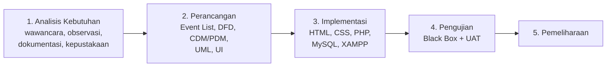
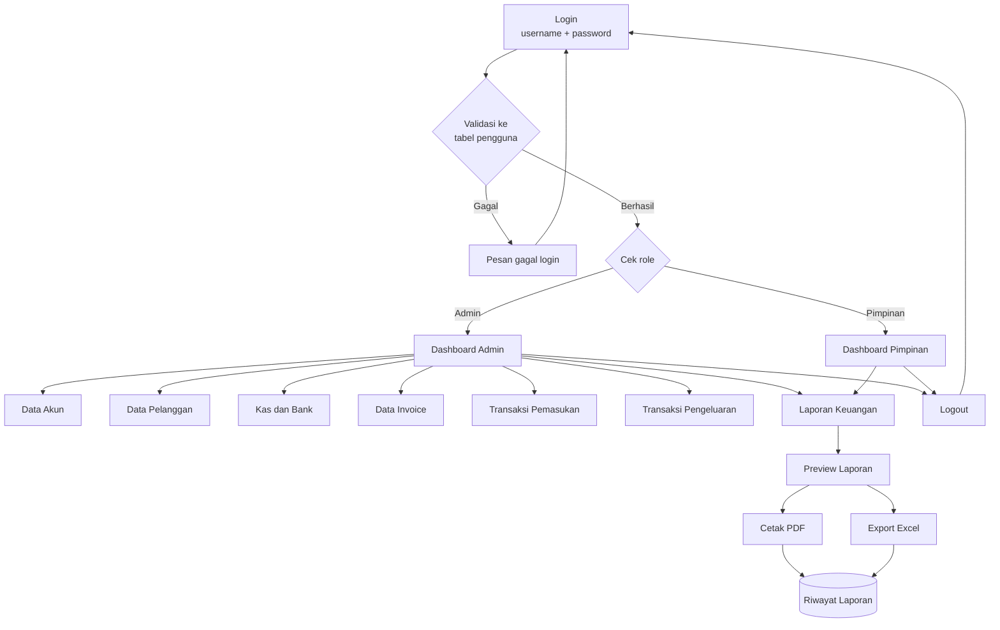
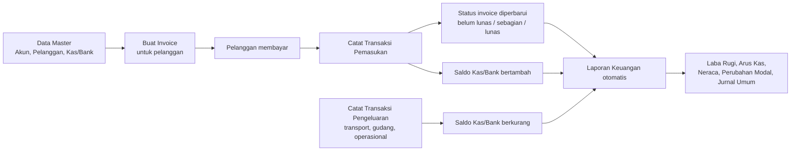
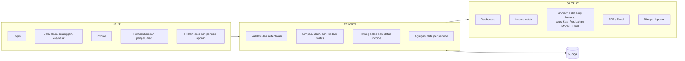
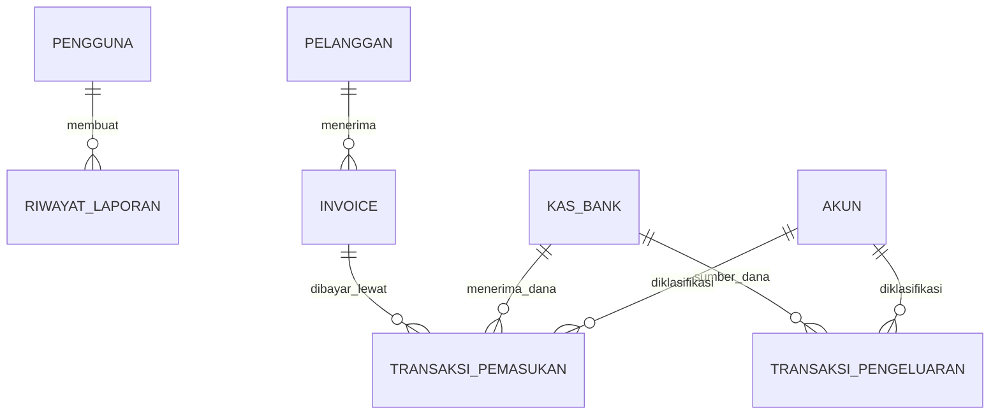

# Sistem Informasi Keuangan Berbasis Web — PT. Bali Surya Sentosa

> Ringkasan khusus bagian **website**: alur sistem, teknologi yang digunakan, serta Input → Proses → Output.
> Sumber: dokumen seminar *Putu Windhi Agustin* (INSTIKI), Bab I–III.

---

## 1. Gambaran Umum

| Item | Keterangan |
|---|---|
| Nama sistem | Sistem Informasi Keuangan Berbasis Web |
| Objek penelitian | PT. Bali Surya Sentosa (jasa kargo ekspor-impor dan domestik, Tuban, Kuta, Badung, Bali) |
| Masalah | Pencatatan keuangan masih manual di Microsoft Excel: salah input, pencarian transaksi sulit, laporan lambat, risiko data hilang |
| Tujuan | Merancang dan membangun sistem keuangan berbasis web yang terintegrasi untuk pengelolaan transaksi dan penyusunan laporan keuangan secara efektif dan efisien |
| Metode pengembangan | **Waterfall** |
| Metode pengujian | **Black Box Testing** dan **UAT** (kuesioner) |
| Periode penelitian | Maret 2026 – Juni 2026 |

### Ruang lingkup (batasan masalah)
- Mencakup: dashboard, data master, transaksi pemasukan & pengeluaran, invoice, kas & bank, laporan keuangan.
- Data hanya terkait jasa kargo ekspor-impor (biaya freight, biaya gudang, jasa pengiriman).
- Tidak membahas proses operasional pengiriman barang secara rinci.

---

## 2. Pengguna (Aktor) dan Hak Akses

| Aktor | Peran di sistem |
|---|---|
| **Admin / Bagian Keuangan** | Mengelola seluruh data: akun, pelanggan, kas & bank, invoice, pemasukan, pengeluaran, membuat dan mencetak laporan |
| **Pimpinan** | Memantau dashboard dan melihat laporan keuangan untuk pengambilan keputusan |

Autentikasi memakai **username + password**. Setelah login, halaman yang tampil disesuaikan dengan role (Dashboard Admin atau Dashboard Pimpinan).

---

## 3. Teknologi yang Digunakan

### Software / stack pengembangan
| Komponen | Fungsi |
|---|---|
| **HTML** | Struktur halaman web |
| **CSS** | Tampilan dan layout |
| **Bootstrap** | Framework front-end untuk UI responsif (dibahas di landasan teori) |
| **PHP** | Bahasa pemrograman sisi server: pemrosesan data, sesi login, koneksi database |
| **MySQL** | Database relasional untuk menyimpan semua data |
| **XAMPP** | Web server lokal (Apache + MySQL + PHP) untuk pengembangan dan pengujian |
| **Power Designer** | Perancangan database (CDM dan PDM) |
| **Web browser** | Chrome, Firefox, atau Edge untuk mengakses sistem |
| **Windows 10/11** | Sistem operasi |

### Hardware minimal
Komputer/laptop dengan RAM 8 GB, prosesor Intel Core i3 atau setara, dan penyimpanan memadai.

### Perancangan dan dokumentasi
Statement of Purpose, Event List, DFD (Context, Level 0, Level 1), CDM, PDM, struktur tabel, UML (Use Case, Activity, Sequence, Class Diagram), rancangan UI.

---

## 4. Alur Pengembangan (Waterfall)

---

## 5. Alur Sistem (Sistem yang Diusulkan)

### 5.1 Alur umum penggunaan

### 5.2 Alur bisnis transaksi (urutan data saling terhubung)

### 5.3 Alur sistem lama vs baru

| Aspek | Sistem berjalan (Excel) | Sistem diusulkan (Web) |
|---|---|---|
| Pencatatan | Ketik manual ke Excel, invoice dibuat terpisah | Input terpusat, tersimpan di database |
| Pencarian transaksi | Sulit dan lama | Pencarian berdasarkan tanggal, no. invoice, jenis transaksi, nama akun |
| Saldo kas/bank | Dihitung manual | Diperbarui otomatis tiap transaksi |
| Laporan | Disusun manual, lambat | Dihasilkan otomatis per periode |
| Risiko | Salah input, data hilang | Validasi sistem, data tersimpan terstruktur |

---

## 6. Modul / Menu Website

| No | Modul | Fitur utama |
|---|---|---|
| 1 | **Login** | Autentikasi username/password, validasi data kosong dan salah, pengalihan sesuai role |
| 2 | **Dashboard** | Total pemasukan, total pengeluaran, saldo kas dan bank, ringkasan laporan (versi Admin dan Pimpinan) |
| 3 | **Data Akun** | Tambah, ubah, cari, update status akun (kas, bank, pendapatan, beban) |
| 4 | **Data Pelanggan** | Tambah, ubah, cari, update status pelanggan |
| 5 | **Kas dan Bank** | Tambah, ubah, cari, update status, validasi saldo, mutasi |
| 6 | **Data Invoice** | Tambah, ubah, cari, lihat detail, cetak, update status invoice |
| 7 | **Transaksi Pemasukan** | Tambah, ubah, cari, update status, update status invoice, cetak laporan pemasukan |
| 8 | **Transaksi Pengeluaran** | Tambah, ubah, cari, update status, cetak laporan pengeluaran |
| 9 | **Laporan Keuangan** | Laba rugi, neraca, arus kas, perubahan modal, jurnal umum, riwayat laporan |
| 10 | **Cetak Laporan** | Preview, cetak PDF, export Excel |
| 11 | **Logout** | Konfirmasi logout (Ya/Batal), kembali ke halaman login |

---

## 7. Input → Proses → Output per Modul

### 7.1 Login
| | Isi |
|---|---|
| **Input** | Username, password |
| **Proses** | Validasi field tidak kosong → cek username dan password di tabel `pengguna` → cek role dan status pengguna → buat sesi |
| **Output** | Berhasil: Dashboard sesuai role. Gagal: pesan gagal login. Kosong: pesan validasi "data harus diisi" |

### 7.2 Dashboard
| | Isi |
|---|---|
| **Input** | Sesi login yang valid |
| **Proses** | Menarik dan menjumlahkan data pemasukan, pengeluaran, dan saldo kas/bank dari database |
| **Output** | Kartu/ringkasan: total pemasukan, total pengeluaran, saldo kas dan bank, ringkasan laporan keuangan |

### 7.3 Data Akun
| | Isi |
|---|---|
| **Input** | Kode akun, nama akun, tipe akun, kategori akun; kata kunci pencarian; status |
| **Proses** | Validasi → simpan/ubah ke tabel `akun` → pencarian → update status |
| **Output** | Daftar akun, notifikasi data tersimpan/berubah, status akun diperbarui. Akun dipakai sebagai referensi transaksi dan laporan |

### 7.4 Data Pelanggan
| | Isi |
|---|---|
| **Input** | Kode pelanggan, nama, alamat, telepon, email |
| **Proses** | Validasi → simpan/ubah ke tabel `pelanggan` → pencarian → update status |
| **Output** | Daftar pelanggan, notifikasi sukses. Data dipakai saat membuat invoice |

### 7.5 Kas dan Bank
| | Isi |
|---|---|
| **Input** | Kode kas/bank, nama, jenis rekening, nomor rekening, saldo |
| **Proses** | Simpan/ubah ke tabel `kas_bank` → validasi saldo → saldo diperbarui otomatis saat ada pemasukan/pengeluaran |
| **Output** | Daftar kas dan bank beserta saldo, informasi mutasi |

### 7.6 Data Invoice
| | Isi |
|---|---|
| **Input** | Pelanggan, nomor invoice, tanggal, jatuh tempo, total tagihan, status |
| **Proses** | Simpan/ubah ke tabel `invoice` → pencarian → tampilkan detail → generate dokumen cetak → update status |
| **Output** | Daftar invoice, detail invoice, invoice siap cetak, status (lunas / sebagian / belum lunas) |

### 7.7 Transaksi Pemasukan
| | Isi |
|---|---|
| **Input** | Invoice terkait, kas/bank tujuan, no. bukti pemasukan, tanggal pembayaran, keterangan, nominal pembayaran |
| **Proses** | Validasi kelengkapan → simpan ke tabel `transaksi_pemasukan` → tambah saldo kas/bank → perbarui status invoice |
| **Output** | Notifikasi tersimpan, saldo kas/bank bertambah, status invoice terbaru, laporan pemasukan (cetak) |

### 7.8 Transaksi Pengeluaran
| | Isi |
|---|---|
| **Input** | No. bukti pengeluaran, tanggal, keterangan/kategori biaya, nominal, kas/bank sumber |
| **Proses** | Validasi → simpan ke tabel `transaksi_pengeluaran` → kurangi saldo kas/bank → sinkronkan catatan pengeluaran |
| **Output** | Notifikasi tersimpan, saldo kas/bank berkurang, laporan pengeluaran (cetak) |

### 7.9 Laporan Keuangan
| | Isi |
|---|---|
| **Input** | Jenis laporan, periode (rentang tanggal) |
| **Proses** | Query data akun, kas/bank, invoice, pemasukan, pengeluaran pada periode → hitung total dan saldo akhir → susun laporan |
| **Output** | Laporan Laba Rugi, Neraca, Arus Kas, Perubahan Modal, Jurnal Umum dalam bentuk tabel/grafik |

### 7.10 Cetak Laporan dan Riwayat
| | Isi |
|---|---|
| **Input** | Pilihan laporan dan periode, tombol Cetak / Unduh PDF / Unduh Excel |
| **Proses** | Preview → konversi ke PDF atau Excel → simpan jejak ke tabel `riwayat_laporan` |
| **Output** | File PDF/Excel, daftar riwayat laporan yang dapat dilihat, dicetak ulang, atau diunduh lagi |

### 7.11 Logout
| | Isi |
|---|---|
| **Input** | Klik tombol Logout |
| **Proses** | Tampilkan konfirmasi → jika **Ya** akhiri sesi; jika **Batal** tetap di halaman |
| **Output** | Kembali ke halaman login (atau tetap di halaman sebelumnya jika batal) |

---

## 8. Ringkasan I-P-O Keseluruhan Sistem

---

## 9. Rancangan Database

### 9.1 Tabel

| Tabel | Field utama |
|---|---|
| **pengguna** | `id_user` (PK), username, password, role, status_pengguna |
| **pelanggan** | `id_pelanggan` (PK), kode_pelanggan, nama_pelanggan, alamat, telepon, email |
| **akun** | `id_akun` (PK), kode_akun, nama_akun, tipe_akun, kategori_akun |
| **kas_bank** | `id_kas_bank` (PK), kode_kas_bank, nama_kas_bank, jenis_kas_bank, no_rekening, saldo |
| **invoice** | `id_invoice` (PK), no_invoice, tanggal, jatuh_tempo, total, status_invoice |
| **transaksi_pemasukan** | `id_pemasukan` (PK), `id_kas_bank` (FK), `id_invoice` (FK), no_bukti_pemasukan, tanggal_pembayaran, keterangan_pembayaran, nominal_pembayaran |
| **transaksi_pengeluaran** | `id_pengeluaran` (PK), no_bukti_pengeluaran, tanggal_pembayaran_pengeluaran, keterangan_pengeluaran, nominal_pengeluaran |
| **riwayat_laporan** | `id_laporan` (PK), `id_user` (FK), jenis_laporan, periode, dibuat_oleh, file_laporan |

### 9.2 Relasi (gambaran)

> Relasi `PELANGGAN–INVOICE`, `AKUN–transaksi`, dan `KAS_BANK–pengeluaran` diambil dari penjelasan teks dokumen. Pada tabel struktur di dokumen, kolom FK-nya belum tertulis (lihat bagian 11).

---

## 10. Pengujian

### Black Box Testing
| Modul | Skenario | Hasil yang diharapkan |
|---|---|---|
| Login | Username/password valid | Masuk ke dashboard sesuai role |
| Login | Username/password salah | Pesan gagal login |
| Login | Field dikosongkan | Validasi data harus diisi |
| Dashboard | Setelah login | Tampil total pemasukan, pengeluaran, saldo, ringkasan laporan |
| Akun, Pelanggan, Kas/Bank, Invoice, Pemasukan, Pengeluaran | Tambah, ubah, cari, update status | Data tersimpan, tampil sesuai pencarian, status diperbarui |
| Invoice | Cetak invoice | Tampil hasil cetak |
| Laporan Keuangan | Pilih periode, cetak, unduh PDF/Excel | Laporan sesuai periode, file terunduh |
| Riwayat Laporan | Buka, cetak, unduh | Daftar laporan lama tampil, bisa dicetak/diunduh |
| Logout | Klik logout → Ya / Batal | Keluar ke login / tetap di halaman |

### UAT (kuesioner, skala SS / S / KS / TS)
- Fungsionalitas: pencatatan pemasukan, pengeluaran, invoice sesuai alur bisnis kargo; laporan laba rugi, arus kas, neraca otomatis dan valid.
- Usability: antarmuka mudah dipahami; pencarian data mempercepat penemuan transaksi.
- Kelayakan: sistem layak menggantikan pencatatan manual Excel.

---

## 11. Catatan Ketidakkonsistenan di Dokumen (perlu dirapikan sebelum seminar)

1. **Batasan masalah** menyebut sistem hanya dipakai admin/keuangan, tetapi perancangan memuat role **Pimpinan** (login, dashboard, laporan).
2. **Hapus vs update status**: DFD dan halaman UI menyebut penghapusan data, sedangkan Event List, kebutuhan fungsional, dan pengujian memakai *update status*.
3. **Laporan Perubahan Modal** ada di Event List dan DFD, tetapi tidak ada di kebutuhan fungsional. **Jurnal Umum** ada di kebutuhan fungsional, tetapi tidak ada di Event List.
4. **Kebutuhan non-fungsional** menyebut akses online, sementara tools hanya XAMPP (server lokal). Perlu dijelaskan rencana hosting atau akses jaringan.
5. **Bootstrap** dibahas di landasan teori tetapi tidak masuk daftar software di 3.3.4.
6. **Struktur tabel**:
   - `invoice` belum punya FK `id_pelanggan`.
   - `transaksi_pemasukan` dan `transaksi_pengeluaran` belum punya FK `id_akun`.
   - `transaksi_pengeluaran` belum punya FK `id_kas_bank`.
   - `nominal_pengeluaran` bertipe Varchar, sebaiknya Integer/Decimal seperti `nominal_pembayaran`.
   - `riwayat_laporan` punya `id_user` dan `dibuat_oleh` (redundan), dan tipe "Integert" salah ketik.
   - Tabel `pengguna` ada atribut `status_pengguna`, tetapi tabel akun, pelanggan, dan kas/bank tidak punya kolom status padahal ada fitur update status.
7. **Penomoran dan judul**: ada "Perancangan Sistem" ganda (3.4 dan 3.5, seharusnya 3.5 = SOP), Gambar 3.16 berjudul "(CDM)" padahal PDM, Tabel 3.2 berjudul "Struktur Tabel Pengguna" padahal Pelanggan, Gambar 3.13 berjudul "Mengelola Data Invoice" padahal Cetak Laporan. Daftar isi (3.10 Struktur Tabel) tidak sama dengan isi (3.10 UML, 3.11 Struktur Tabel).
8. **Sistematika penulisan** menyebut lima bab, tetapi isi dokumen baru Bab I–III.
