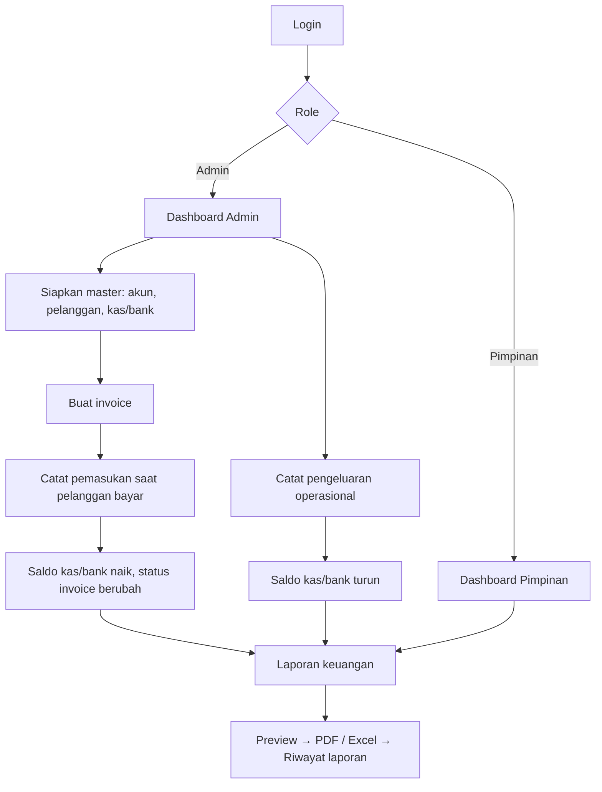

# PRD — Sistem Informasi Keuangan Berbasis Web (PT. Bali Surya Sentosa)

| | |
|---|---|
| Versi | 1.0 (MVP) |
| Basis | Dokumen seminar Putu Windhi Agustin, Bab I–III |
| Metode | Waterfall |
| Stack | PHP native, MySQL, Bootstrap 5, XAMPP |
| Pembaruan | Jawaban pertanyaan terbuka sudah dimasukkan (PPN, multi-item, 1 Admin + 1 Pimpinan, online, kop) |
| Dokumen pendamping | `DESIGN.md` (arsitektur teknis dan desain UI) |

---

## 1. Latar Belakang dan Masalah

PT. Bali Surya Sentosa (jasa kargo ekspor-impor dan domestik) mencatat seluruh transaksi keuangan di Microsoft Excel. Dampaknya:

- Salah input data (human error).
- Pencarian transaksi sulit dan lama.
- Rekonsiliasi dan penyusunan laporan lambat.
- Risiko data hilang.
- Invoice dibuat terpisah dari pencatatan transaksi.

## 2. Tujuan Produk

1. Memusatkan pencatatan invoice, pemasukan, pengeluaran, dan kas/bank dalam satu sistem web.
2. Memperbarui saldo kas/bank dan status invoice secara otomatis.
3. Menghasilkan laporan keuangan otomatis: Laba Rugi, Neraca, Arus Kas, Perubahan Modal, Jurnal Umum.
4. Memberi Pimpinan akses pantau (read-only) ke dashboard dan laporan.

### Indikator keberhasilan
| Indikator | Target |
|---|---|
| Seluruh skenario Black Box lulus | 100% |
| UAT: responden Setuju/Sangat Setuju | ≥ 80% |
| Waktu membuat satu laporan keuangan | < 5 detik untuk data 1 tahun |
| Pencarian transaksi | < 2 detik |
| Pencatatan manual Excel digantikan | Ya |

## 3. Ruang Lingkup

### Termasuk (In scope)
Login/logout, dashboard, data akun, data pelanggan, kas & bank, invoice (multi-item + PPN), transaksi pemasukan, transaksi pengeluaran, laporan keuangan, cetak PDF/Excel, riwayat laporan, pengaturan kop perusahaan.

### Tidak termasuk (Out of scope)
- Operasional pengiriman barang (tracking, manifest, jadwal).
- Payroll, PPh, pelaporan SPT/e-Faktur, dan multi-mata uang. (PPN pada invoice **termasuk** dalam lingkup.)
- Integrasi bank/payment gateway.
- Aplikasi mobile native.
- Multi-cabang/multi-perusahaan.

> Data hanya terkait jasa kargo: biaya freight, biaya gudang, jasa pengiriman.

## 4. Pengguna dan Hak Akses

| Role | Deskripsi | Hak akses |
|---|---|---|
| **Admin** (Bagian Keuangan) | Mengoperasikan sistem harian. **Hanya 1 orang** | CRUD semua modul, atur kop perusahaan, buat/cetak laporan, lihat riwayat |
| **Pimpinan** | Memantau kondisi keuangan. **Hanya dipegang pimpinan kantor (1 akun)** | Dashboard Pimpinan dan Laporan Keuangan (read-only, boleh cetak/unduh), riwayat laporan |

Karena hanya ada 2 akun tetap, tidak ada modul manajemen pengguna. Akun dibuat lewat seed; yang tersedia hanya fitur **ganti password** sendiri.

Matriks akses:

| Modul | Admin | Pimpinan |
|---|:--:|:--:|
| Login / Logout | ✔ | ✔ |
| Dashboard | ✔ (Admin) | ✔ (Pimpinan) |
| Data Akun | ✔ | ✘ |
| Data Pelanggan | ✔ | ✘ |
| Kas & Bank | ✔ | ✘ |
| Invoice | ✔ | ✘ |
| Transaksi Pemasukan | ✔ | ✘ |
| Transaksi Pengeluaran | ✔ | ✘ |
| Laporan Keuangan | ✔ | ✔ |
| Riwayat Laporan | ✔ | ✔ |
| Pengaturan Kop Perusahaan | ✔ | ✘ |
| Ganti Password (milik sendiri) | ✔ | ✔ |

## 5. Alur Pengguna Utama

## 6. Kebutuhan Fungsional

Prioritas: **P0** = wajib MVP, **P1** = penting, **P2** = nice to have.

### FR-01 Autentikasi (P0)
- FR-01.1 Login dengan username dan password.
- FR-01.2 Validasi field kosong → pesan "data harus diisi".
- FR-01.3 Kredensial salah → pesan gagal login (tanpa menyebut mana yang salah).
- FR-01.4 Akun berstatus nonaktif tidak bisa login.
- FR-01.5 Setelah login, arahkan ke dashboard sesuai role.
- FR-01.6 Logout dengan dialog konfirmasi (Ya / Batal); Ya mengakhiri sesi dan kembali ke login.

### FR-02 Dashboard (P0)
- Admin: total pemasukan, total pengeluaran, saldo kas dan bank, ringkasan laporan, invoice belum lunas / jatuh tempo.
- Pimpinan: ringkasan yang sama dalam tampilan monitoring (tanpa tombol aksi data).
- Filter periode bulan berjalan (default).

### FR-03 Data Akun (P0)
- Tambah, ubah, cari, update status (aktif/nonaktif).
- Field: kode akun, nama akun, tipe akun (Aset, Kewajiban, Modal, Pendapatan, Beban), kategori.
- Kode akun unik. Akun yang sudah dipakai transaksi tidak boleh dihapus, hanya dinonaktifkan.

### FR-04 Data Pelanggan (P0)
- Tambah, ubah, cari, update status.
- Field: kode, nama, alamat, telepon, email. Kode pelanggan unik.

### FR-05 Kas dan Bank (P0)
- Tambah, ubah, cari, update status, validasi saldo, tampilan mutasi.
- Field: kode, nama, jenis (Kas/Bank), nomor rekening, saldo awal.
- Saldo berubah hanya lewat transaksi (tidak diedit langsung setelah ada mutasi).
- Pengeluaran ditolak jika saldo tidak cukup.

### FR-06 Invoice (P0)
- Tambah, ubah, cari, lihat detail, cetak, update status.
- Field header: nomor invoice (otomatis), pelanggan, tanggal, jatuh tempo, keterangan, status.
- **Banyak item layanan per invoice.** Tiap item: jenis layanan (freight / gudang / pengiriman / lainnya), deskripsi, qty, satuan, harga satuan, subtotal baris.
- **PPN:** persentase PPN per invoice (default dari pengaturan, 11%, dapat diubah atau 0% bila tidak kena PPN). Sistem menghitung Subtotal, PPN, dan Total.
- Status: `belum_lunas`, `sebagian`, `lunas`, `batal`. Status `sebagian`/`lunas` ditentukan sistem dari total pembayaran.
- Invoice yang sudah memiliki pembayaran tidak bisa diubah item dan total-nya.

### FR-07 Transaksi Pemasukan (P0)
- Tambah, ubah, cari, update status, cetak laporan pemasukan.
- Input: invoice, kas/bank tujuan, akun pendapatan, tanggal bayar, no. bukti (otomatis), keterangan, nominal.
- Saat disimpan: saldo kas/bank bertambah dan status invoice diperbarui otomatis.
- Nominal tidak boleh melebihi sisa tagihan invoice.

### FR-08 Transaksi Pengeluaran (P0)
- Tambah, ubah, cari, update status, cetak laporan pengeluaran.
- Input: kas/bank sumber, akun beban, tanggal, no. bukti (otomatis), keterangan, nominal, bukti transaksi (opsional, lampiran).
- Saat disimpan: saldo kas/bank berkurang.

### FR-09 Pencarian Transaksi (P1)
Cari berdasarkan tanggal, nomor invoice, jenis transaksi, dan nama akun.

### FR-10 Laporan Keuangan (P0)
Pilih jenis laporan dan periode, lalu sistem menghitung otomatis:
- Laba Rugi
- Neraca
- Arus Kas
- Perubahan Modal
- Jurnal Umum

### FR-11 Cetak dan Ekspor (P0)
- Preview laporan, cetak PDF, export Excel.
- Setiap laporan yang dicetak/diunduh tercatat di Riwayat Laporan.

### FR-12 Riwayat Laporan (P1)
Daftar laporan yang pernah dibuat (jenis, periode, tanggal, pembuat); dapat dibuka, dicetak ulang, dan diunduh.

### FR-13 Pengaturan Kop Perusahaan (P0)
- Admin dapat mengisi dan mengubah: logo (unggah jpg/png), nama perusahaan, alamat, telepon, email, NPWP, rekening pembayaran (bank, nomor, atas nama), nama penandatangan dan jabatan, catatan kaki invoice, tarif PPN default.
- Kop ini dipakai otomatis pada **cetak invoice** dan **semua laporan** (PDF dan pratinjau); Excel memuat nama dan alamat di baris atas.
- **Placeholder bawaan:** sebelum diisi, kop menampilkan kotak logo kosong dan teks contoh ("Nama Perusahaan", "Alamat perusahaan", dst.) sehingga sistem langsung bisa dipakai.
- Pratinjau kop ditampilkan langsung di halaman pengaturan.
- **Dua mode kop** (Admin memilih salah satu):
  1. **Kop gambar penuh (disarankan, karena perusahaan sudah punya kop):** unggah file kop berupa JPG/PNG; ditampilkan utuh di bagian atas invoice dan laporan.
  2. **Kop disusun sistem:** logo + teks dari isian di atas.
- Kop yang berupa **PDF** harus dikonversi ke JPG/PNG sebelum diunggah (sistem hanya menerima jpg/png). Disarankan lebar minimal 1600 px agar tajam saat dicetak.
- Tarif PPN default 11% berlaku untuk semua layanan; tetap bisa diubah per invoice.

## 7. Aturan Bisnis (Business Rules)

| Kode | Aturan |
|---|---|
| BR-01 | Pemasukan menambah saldo kas/bank; pengeluaran menguranginya. Keduanya dalam satu transaksi database (atomic). |
| BR-02 | Status invoice: total bayar = 0 → `belum_lunas`; 0 < bayar < total → `sebagian`; bayar ≥ total → `lunas`. |
| BR-03 | Pembayaran tidak boleh melebihi sisa tagihan. |
| BR-04 | Pengeluaran tidak boleh membuat saldo kas/bank negatif. |
| BR-05 | Data master yang sudah dipakai transaksi tidak dihapus, hanya dinonaktifkan. |
| BR-06 | Ubah/hapus transaksi harus mengoreksi saldo dan status invoice terkait. |
| BR-07 | Setiap transaksi pemasukan/pengeluaran otomatis membentuk entri jurnal (debit = kredit). |
| BR-08 | Nomor invoice dan nomor bukti dibuat otomatis, unik, format `INV-YYYYMM-0001`, `BKM-YYYYMM-0001` (masuk), `BKK-YYYYMM-0001` (keluar). |
| BR-09 | Hanya Admin yang dapat mengubah data; Pimpinan read-only. |
| BR-10 | Total invoice = Σ subtotal item + PPN (`subtotal × tarif PPN`). Pembulatan 2 desimal, dihitung di server. |
| BR-11 | PPN bukan pendapatan. Pada pembayaran, nominal dipecah proporsional: bagian PPN dicatat ke akun **PPN Keluaran** (kewajiban), sisanya ke akun pendapatan. |
| BR-12 | Hanya ada 1 akun Admin dan 1 akun Pimpinan; tidak ada pendaftaran pengguna baru lewat aplikasi. |

## 8. Kebutuhan Non-Fungsional

| Kategori | Kebutuhan |
|---|---|
| Platform | Web, dapat diakses via Chrome, Firefox, Edge pada laptop/komputer |
| Performa | Halaman < 2 detik, laporan < 5 detik |
| Keamanan | **HTTPS wajib** (karena diakses online), password di-hash (`password_hash`), prepared statement (anti SQL injection), proteksi CSRF, escape output (anti XSS), session timeout, batas percobaan login, kontrol akses per role di sisi server |
| Ketersediaan data | Backup database berkala (dump MySQL) |
| Usability | Antarmuka sederhana, konsisten, bahasa Indonesia, responsif |
| Kompatibilitas | Hardware minimal Core i3, RAM 8 GB; Windows 10/11 |
| Deploy | Dikembangkan di XAMPP lokal dan dikelola di Git; **dirilis ke hosting PHP 8.1+/MySQL dengan domain dan SSL** (penyedia ditentukan belakangan) agar dapat diakses online |

## 9. Model Data (ringkas)

Tabel: `pengguna`, `pelanggan`, `akun`, `kas_bank`, `invoice`, `transaksi_pemasukan`, `transaksi_pengeluaran`, `riwayat_laporan`, ditambah `invoice_item`, `pengaturan_perusahaan`, `jurnal`, dan `jurnal_detail` (lihat `DESIGN.md` bagian Database).

## 10. Penyesuaian terhadap Dokumen Seminar

Keputusan agar sistem konsisten dan dapat dibangun. Ubah dokumen bila diperlukan.

| # | Di dokumen | Keputusan PRD |
|---|---|---|
| 1 | Batasan: hanya admin/keuangan | Ada 2 role: **Admin** dan **Pimpinan** (read-only) |
| 2 | DFD: ada "hapus"; Event List: "update status" | Memakai **update status** (soft delete); tidak ada hapus permanen |
| 3 | Tabel `invoice` tanpa FK pelanggan | Tambah `id_pelanggan` |
| 4 | Pemasukan/pengeluaran tanpa FK akun | Tambah `id_akun` |
| 5 | Pengeluaran tanpa FK kas/bank | Tambah `id_kas_bank` |
| 6 | `nominal_pengeluaran` Varchar | Diubah ke `DECIMAL(15,2)` |
| 7 | `riwayat_laporan` punya `id_user` dan `dibuat_oleh` | Cukup `id_user` |
| 8 | Akun/pelanggan/kas-bank tanpa kolom status | Tambah kolom `status` |
| 9 | Jurnal Umum dan Neraca tanpa tabel pendukung | Tambah `jurnal` dan `jurnal_detail` |
| 10 | Perubahan Modal ada di Event List tapi tidak di kebutuhan fungsional | Dimasukkan sebagai laporan (FR-10) |
| 11 | Akses online vs XAMPP lokal | Dev di XAMPP; **rilis ke hosting online dengan HTTPS** |
| 12 | Invoice satu total | Invoice **multi-item** (tabel `invoice_item`) |
| 13 | Tidak ada pajak | **PPN** pada invoice, dicatat ke akun PPN Keluaran |
| 14 | Tidak ada pengaturan perusahaan | Tambah modul **Pengaturan Kop** (logo, alamat, rekening) dengan placeholder bawaan |
| 15 | Jumlah pengguna tidak dibatasi | 1 Admin + 1 Pimpinan, tanpa modul manajemen pengguna |

## 11. Pengujian dan Kriteria Penerimaan

### Black Box (lampiran skenario dokumen seminar)
Login (valid/salah/kosong), dashboard, CRUD tiap master, invoice (cetak), pemasukan, pengeluaran, laporan (periode, PDF, Excel), riwayat (cetak, unduh), logout (Ya/Batal).

### Tambahan kriteria
- Pemasukan → saldo dan status invoice benar.
- Pembayaran melebihi tagihan ditolak.
- Pengeluaran melebihi saldo ditolak.
- Pimpinan tidak bisa membuka URL modul Admin (respons 403).
- Total debit = total kredit pada jurnal.
- Neraca seimbang (Aset = Kewajiban + Modal).

### UAT
Kuesioner SS/S/KS/TS: fungsionalitas, usability, kelayakan menggantikan Excel.

## 12. Rencana Rilis (Waterfall)

| Fase | Keluaran | Estimasi |
|---|---|---|
| 1. Analisis | PRD final, data contoh dari Excel | 1 minggu |
| 2. Perancangan | DESIGN.md, ERD/PDM final, mockup UI | 1–2 minggu |
| 3. Implementasi | Modul sesuai urutan di bawah | 4–5 minggu |
| 4. Pengujian | Black Box, UAT, perbaikan | 1–2 minggu |
| 5. Pemeliharaan | Backup, perbaikan bug | Berkelanjutan |

Urutan implementasi: (1) setup + login + layout → (2) master akun, pelanggan, kas/bank → (3) invoice → (4) pemasukan + pengeluaran + jurnal otomatis → (5) laporan → (6) cetak PDF/Excel + riwayat → (7) dashboard → (8) pengujian.

## 13. Risiko dan Asumsi

| Risiko / Asumsi | Mitigasi |
|---|---|
| Pengguna terbiasa Excel | Tampilan sederhana, import data awal, pelatihan singkat |
| Saldo awal dan data lama belum rapi | Siapkan saldo awal per kas/bank dan modal awal sebelum go-live |
| Aturan akuntansi (jurnal, bagan akun) | Validasi bagan akun dengan bagian keuangan perusahaan |
| Kesalahan hitung laporan | Uji dengan data contoh yang hasilnya sudah diketahui dari Excel |
| Asumsi | Satu perusahaan, mata uang Rupiah, PPN satu tarif per invoice, pengguna hanya 2 akun (1 Admin, 1 Pimpinan) |
| Sistem online berisiko diserang | HTTPS, batas percobaan login, backup harian di luar server hosting, `display_errors` mati |

## 14. Pertanyaan Terbuka

### Sudah terjawab
| Pertanyaan | Jawaban | Dampak |
|---|---|---|
| Perlu PPN pada invoice? | Ya | BR-10, BR-11, akun PPN Keluaran |
| Invoice banyak item? | Ya, banyak item layanan | `invoice_item`, FR-06 |
| Akun Pimpinan dan jumlah Admin? | Pimpinan kantor saja; Admin hanya 1 orang | BR-12, tanpa manajemen pengguna |
| Online atau jaringan kantor? | Online | HTTPS wajib, deploy ke hosting |
| Format kop? | Perusahaan sudah punya kop (PDF/JPG); sistem menyediakan placeholder dan pengaturan kop | FR-13: mode kop gambar penuh jadi P0 |
| Semua layanan kena PPN 11%? | Ya, semua | Default 11% untuk semua layanan |
| Perlu nomor faktur pajak? | Tidak, cukup nomor invoice | Tidak ada modul faktur pajak |
| Hosting dan domain? | Ditentukan belakangan; dikembangkan lokal dulu, kode di-push ke Git | Dev di XAMPP, repositori Git |

### Masih terbuka
1. Penyedia hosting dan domain (ditentukan menjelang rilis).
2. Berkas kop final (JPG/PNG) untuk diunggah setelah sistem jadi.
